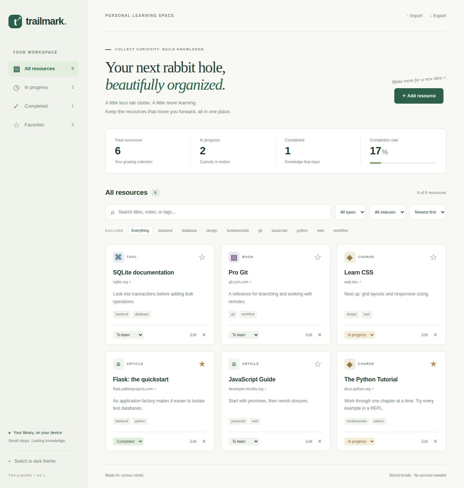

# Trailmark

**Collect curiosity. Build knowledge.**

A personal learning library built with **Python, Flask, vanilla JavaScript, and SQLite**. Save useful links, organize them with tags, and move from “I'll read this later” to “I learned something.”

Trailmark is a working, single-user local app. **9 of the 12 features below are implemented.** The remaining 3 are an explicit roadmap, with no API keys, unfinished services, or placeholder buttons required to run the app.



## Features and implementation status

| # | Feature | Status | What you can do today |
|---|---|---|---|
| 1 | Resource library | ✅ Implemented | Add, edit, open, and delete articles, videos, courses, books, and tools; persist them in SQLite. |
| 2 | Tags and organization | ✅ Implemented | Add up to 12 tags per resource and filter by a tag. |
| 3 | Search, filters, and sorting | ✅ Implemented | Search titles, URLs, notes, and tags; combine type/status filters; sort by date or title. |
| 4 | Learning progress | ✅ Implemented | Move resources through To learn → In progress → Completed, including directly from a card. |
| 5 | Favorites | ✅ Implemented | Star resources and browse a dedicated Favorites view. |
| 6 | Personal notes | ✅ Implemented | Save plain-text takeaways with each resource; open Edit to read or update the full note. |
| 7 | Progress dashboard | ✅ Implemented | See library totals, in-progress counts, completed counts, and completion percentage. |
| 8 | JSON backup and import | ✅ Implemented | Export the entire library; import compatible backups, skip duplicate URLs, and reject invalid batches without partial writes. |
| 9 | Responsive interface and themes | ✅ Implemented | Use mobile or desktop layouts and a light/dark theme saved in your browser. |
| 10 | Automatic link metadata | 📝 Planned | Fetch page titles and descriptions. **Current alternative:** enter the title and notes manually. |
| 11 | Browser extension | 📝 Planned | Save the current tab with one click. **Current alternative:** copy its link into Add resource. |
| 12 | Accounts and cross-device sync | 📝 Planned | Authenticated accounts and synchronized libraries. **Current alternative:** use a local library and JSON backups. |

**Nothing in rows 10–12 is implemented or needed by rows 1–9.** Planned scope and acceptance criteria live in [ROADMAP.md](ROADMAP.md).

## Quick start

Requirements: **Python 3.11+** and a modern browser. Node.js is needed only to run JavaScript development checks. There is no frontend build step or npm dependency installation.

Clone the repository, then open the project folder:

```bash
git clone https://github.com/mukesh-mehta/trailmark.git
cd trailmark
```

If you already downloaded or cloned the project, open a terminal in that folder instead.

### macOS / Linux

```bash
python3 -m venv .venv
source .venv/bin/activate
python -m pip install -r requirements.txt
python -m trailmark
```

### Windows PowerShell

```powershell
py -3 -m venv .venv
.\.venv\Scripts\python.exe -m pip install -r requirements.txt
.\.venv\Scripts\python.exe -m trailmark
```

Open **http://127.0.0.1:5000**. The database is created automatically. A new library starts empty; press **Add resource** to save your first link. Keep the terminal running while using the app; press **Ctrl+C** to stop it.

### Optional demo data

With the virtual environment active, run this before starting the server (or refresh the page afterward):

```bash
python -m flask --app trailmark seed
```

On Windows, replace `python` with `.\.venv\Scripts\python.exe`. This adds six public learning resources. Repeating it skips existing URLs and does not overwrite your entries. Demo data is optional, not a startup dependency.

## A two-minute walkthrough

1. Add a resource with a title, an `http://` or `https://` link, a type, and some tags.
2. Add notes about why you saved it. Notes are plain text, not HTML or Markdown.
3. Choose **In progress** from the card when you start learning.
4. Star a useful resource; find it again under **Favorites**.
5. Search a word or click a tag. Type and status filters combine with the current view.
6. Mark the resource **Completed** and watch the dashboard update.
7. Click **Export** to download your whole library as JSON.

The dashboard always describes the **whole library**. The count above the cards describes the **current filtered view**. All search words must match somewhere in a resource's title, URL, notes, or tags. **Reset filters** returns to the full library.

## Storage and backups

- Data is stored in `instance/trailmark.sqlite3` inside this project. The database, virtual environment, and local caches are excluded from Git.
- The server does not fetch saved URLs or send your library to external services. Opening a saved link navigates your browser to that site. Internet access is needed to install Python dependencies and visit external links; the library itself works without it.
- Theme preference is stored separately in the browser's `localStorage`.
- **Export** downloads all records, regardless of filters. Treat backups as personal data if your links or notes are private.
- **Import** accepts Trailmark JSON with `schema_version: 1`, up to 1,000 records and a 1 MiB request body. It validates the entire batch first. Invalid entries cause a readable error and no imports.
- Import merges records by normalized URL; existing URLs are skipped, never overwritten. Normalization lowercases scheme/host and adds `/` for a bare host. Other differences, including query strings and fragments, remain distinct.
- Imported records receive new database IDs and creation/update timestamps. Title, URL, type, status, tags, notes, and favorite state are preserved. For an exact database copy, stop the server and copy `instance/trailmark.sqlite3` instead.
- Export is not size-limited, so a library larger than the import limits needs a database-file backup or smaller import batches.

To choose a different database location, set `TRAILMARK_DATABASE` before launch. An absolute path is recommended:

```bash
TRAILMARK_DATABASE=/absolute/path/library.sqlite3 python -m trailmark
```

## Architecture

```text
Browser: HTML + CSS + JavaScript modules
              │ same-origin JSON requests
              ▼
Python / Flask: validation + REST endpoints
              │ parameterized SQL + transactions
              ▼
SQLite: local, persistent resource library
```

The Flask application factory initializes storage and serves the interface and API from the same origin. JavaScript handles rendering, filtering, sorting, and accessible form controls. SQL operations use parameters; user text is inserted into the DOM as text rather than HTML. Failed saves preserve the editor contents.

```text
trailmark/
├── trailmark/
│   ├── __init__.py          # App factory, validation, SQLite, API, seed command
│   ├── __main__.py          # Local startup entry point
│   ├── sample_data.py       # Optional demo resources
│   ├── templates/index.html
│   └── static/
│       ├── app.js           # Browser events, API calls, and rendering
│       ├── library.js       # Pure search, sorting, tags, and statistics helpers
│       ├── style.css
│       └── favicon.svg
├── tests/                  # Python integration tests and JavaScript unit tests
├── docs/                   # Research, API reference, and screenshot
├── .github/workflows/      # GitHub Actions checks
├── requirements.txt
├── requirements-dev.txt
├── package.json
├── ROADMAP.md
└── LICENSE
```

See [API documentation](docs/API.md) for endpoints, example requests, and error formats.

## Run the tests

From the project directory, with the Python virtual environment active:

```bash
python -m pip install -r requirements-dev.txt
python -m pytest -q
npm run check
npm test
```

Use Node.js **18+** for the JavaScript checks (CI uses Node 22). `npm install` is unnecessary: tests use Node's built-in test runner. Python tests use temporary databases, never your real library.

Coverage includes create/edit/delete, persistence across app instances, input validation, duplicate handling, import atomicity, backup round-trips, request protections, seed idempotency, combined filters, sorting, and dashboard calculations. GitHub Actions runs these checks on Python 3.11, 3.12, and 3.13.

## Repository workflow

The repository is [mukesh-mehta/trailmark](https://github.com/mukesh-mehta/trailmark). For a change, start a focused branch from the latest `main`:

```bash
git switch main
git pull --ff-only
git switch -c feat/your-feature
```

Make your change and run the checks in **Run the tests**. Then stage the relevant files, review the diff, and commit:

```bash
git add path/to/changed-file
git diff --cached --stat
git diff --cached
git commit -m "feat: describe the change"
git push -u origin feat/your-feature
```

Replace the example branch name and file path with your own. Open a pull request to `main` on GitHub and wait for the tests to pass before merging. Use `fix:`, `test:`, or `docs:` when those better describe a commit.

Before committing, check that the staged files contain no databases, personal backups, virtual environment, or secrets. Default Trailmark backup filenames are ignored; keep backups with custom filenames outside the repository.

**GitHub hosts the source code. GitHub Pages cannot run this Python backend.** Other people can clone the repository and run the app locally.

## Limits and troubleshooting

- This release is for **one person on their own computer**. It has no authentication, user separation, or public hosting configuration. It binds to loopback and accepts localhost hosts; do not expose it to the public internet.
- The built-in Flask server is for local development. Public hosting requires authentication, a production server, configuration, and further review.
- Search and rendering load the full library into the browser. This version is intended for small personal collections; pagination and large-library optimization are not included.
- Saved pages are not archived. Notes and links remain available locally, but the linked content may require internet access or disappear.
- **Port 5000 is busy:** run `python -m flask --app trailmark run --host 127.0.0.1 --port 5001`, then open `http://127.0.0.1:5001`.
- **Missing Flask:** activate the environment and run `python -m pip install -r requirements.txt`.
- **`venv` is unavailable on Debian/Ubuntu:** install your distribution's `python3-venv` package, then retry setup.
- **Cannot reach Trailmark:** restart the Python process and use **Try again**. Do not open `index.html` directly from disk.
- **Duplicate URL:** edit the existing resource or use a different URL. Titles need not be unique.
- **Import rejected:** check the displayed error, schema version, record limits, and file size. Existing data is preserved.

## Research and inspiration

Three ideas were considered: a learning/bookmark library, a website-change monitor, and a job-application tracker. Existing projects demonstrate the use cases: [linkding](https://github.com/sissbruecker/linkding), [changedetection.io](https://github.com/dgtlmoon/changedetection.io), and [Job Tracker](https://github.com/mquadros/job-tracker).

The learning library was selected because its core workflow is useful without paid APIs, background workers, scraping, or accounts, while offering a clear Python/JavaScript split. This is a new implementation, not a fork of those repositories. See [the research notes](docs/RESEARCH.md) for the comparison and sources.

## Contributing and license

Contributions are welcome. Start with [CONTRIBUTING.md](CONTRIBUTING.md) and the scoped roadmap. Licensed under the [MIT License](LICENSE).
